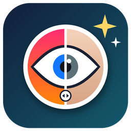
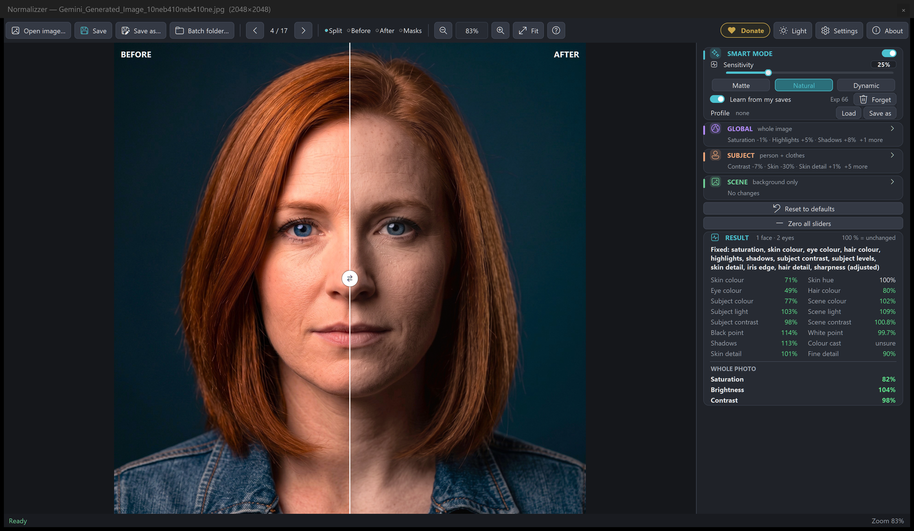
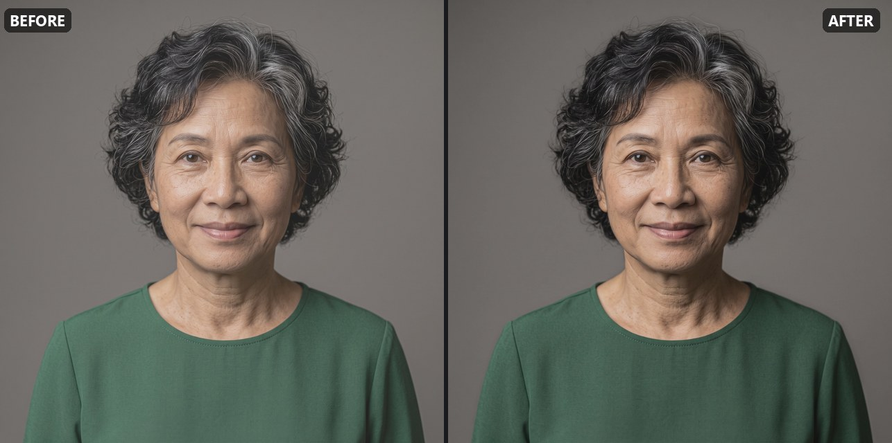
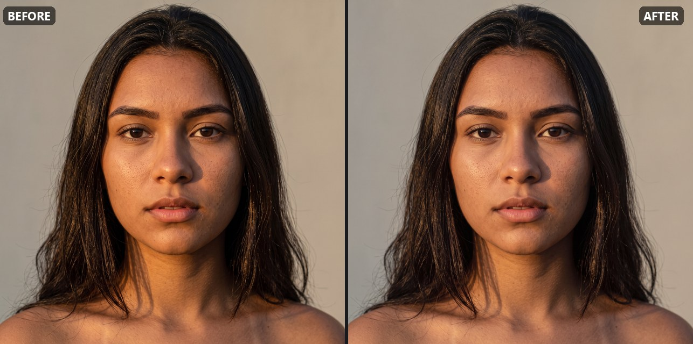
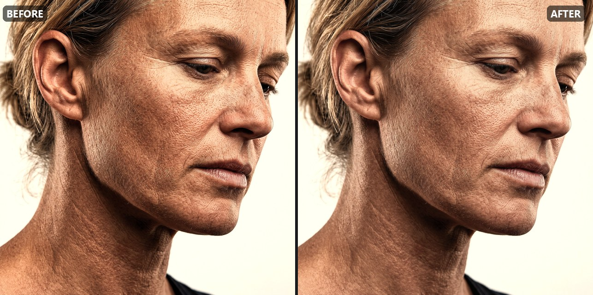
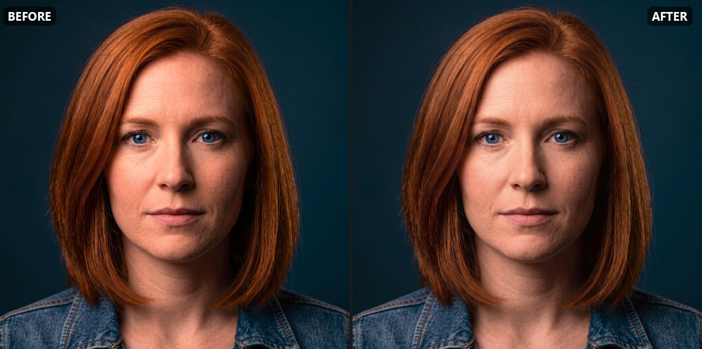
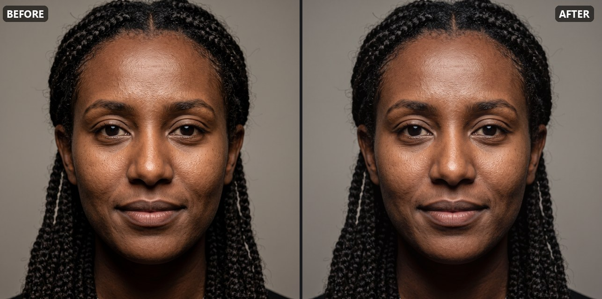
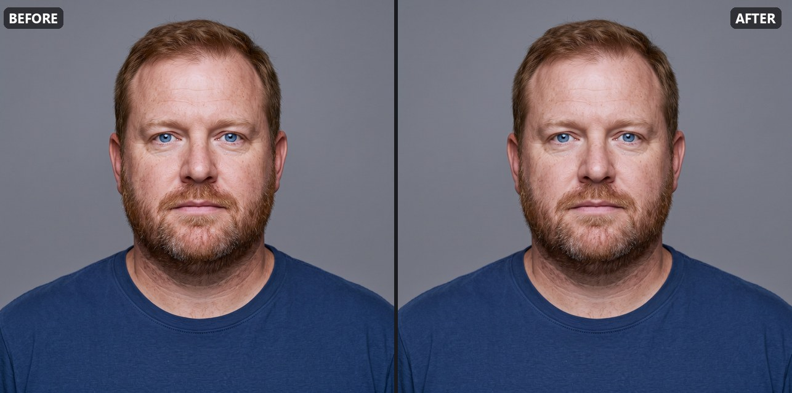
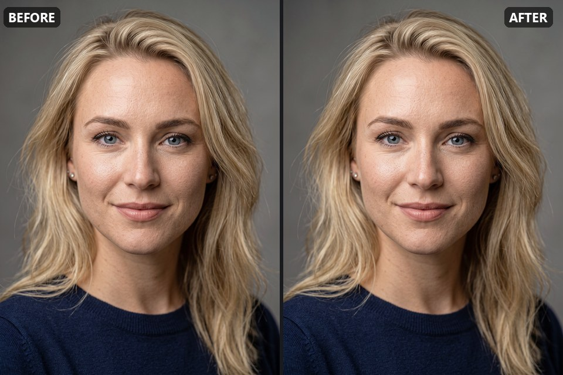
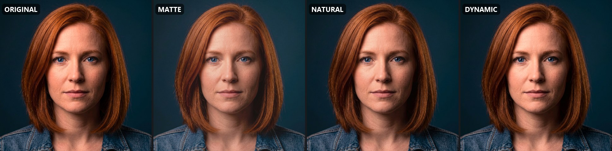

<p align="center">
  
</p>

<h1 align="center">Normalizzer</h1>
<p align="center"><b>Make AI portraits and over-processed photos look natural again — automatically.</b><br>
Version 1.8.1 &bull; Freeware &bull; Windows x64 &bull; Portable &bull; 100 % offline</p>

<p align="center">
  <a href="https://paypal.me/gazeomatic"></a>
</p>

---

<p align="center"><br>
<sub>Smart mode's fix plus two sliders set by hand (Eyes −55 %, Skin −30 %): eye colour 49 %, skin colour 71 % of the original.</sub></p>

**Neon skin. Glowing irises. Orange hair. Crunchy detail and harsh contrast.** AI generators, upscalers, beauty filters and phone processing all love to overdo it — and once you notice it, you can't unsee it.

**Normalizzer finds what is overdone in each photo and dials back just that** — skin, eyes, hair, contrast, shadows, colour cast — while everything that already looks right stays exactly as it was. Open a photo and the fix is already there. Or drop in a whole folder and let it work through hundreds of images.

**On this page:** [Why Normalizzer](#why-normalizzer) · [Features](#what-you-get) · [Examples](#examples) · [Quick start](#quick-start) · [Smart mode](#smart-mode) · [Processing pipeline](#processing-pipeline) · [Controls](#controls-and-settings) · [Using the app](#using-the-app) · [Formats and saving](#supported-formats-and-image-data) · [Command line](#command-line-batch-processing) · [Version history](#version-history)

## 💡 Why Normalizzer

- 🧠 **It thinks before it touches.** Smart mode measures every photo — skin colour, iris colour, hair, contrast, shadows, colour cast, over-sharpening — and fixes only what is actually wrong. Photos that already look natural are left alone.
- 🎯 **It works on the right parts of the picture.** Face, skin, eyes, hair, the person and the background are found separately, so calming orange skin doesn't wash out a blue sweater, and taming a neon iris doesn't grey the whole face.
- 📦 **It scales.** Batch-process a folder of hundreds of AI portraits or a training dataset in one go, with a CSV report of what was done to each image.
- 🎓 **It learns your taste.** Save a photo after your own tweaks and Smart mode applies your style to similar photos from then on. Keep different tastes as **profiles** and switch between them.
- 🎚️ **You stay in control.** One **Sensitivity** slider decides how much gets fixed (0 % = nothing, higher = more and stronger), three **looks** — Matte, Natural, Dynamic — set the mood, and every correction is a slider you can override.
- 🔒 **Private, free and portable.** Everything runs on your own PC: no uploads, no account, no ads, no tracking, no installer. Unzip and run.

## ✨ What you get

| Feature | What it does |
| --- | --- |
| **Smart mode** | Analyses each photo and decides which corrections it needs — and how much. Natural-looking photos are left unchanged. |
| **Natural skin, eyes and hair** | Reduces over-saturated, orange or red skin, glowing irises (with a lower natural level for blue eyes) and over-coloured hair. |
| **Balanced tone** | Softens harsh contrast, restores washed-out blacks, opens crushed shadows and removes colour casts — keeping blacks deep and whites clean. |
| **Detail control** | Tames crunchy, over-sharpened AI skin and textures, or adds crispness where you want it. |
| **Three looks** | **Matte**, **Natural** or **Dynamic**: Smart mode leans every photo toward a softer or a punchier result. |
| **Teach Smart + profiles** | Learns your preferred settings from the photos you save; save and load what it learned as profiles. |
| **Global / Subject / Scene controls** | Adjust the whole image, just the person, or just the background — each with its own Levels. |
| **Before / after comparison** | Draggable split view, before / after / masks views, zoom and pan, and a pixel probe with RGB and Lab values. |
| **Result card in percent** | See at a glance what changed: every measurement as a percentage of the original (100 % = unchanged). |
| **Batch processing** | A whole folder in one go, with progress, cancel and a CSV report. |
| **Full-resolution output** | Saves at the original size and keeps ICC colour profiles, EXIF and transparency where the format allows. |
| **Comfortable to use** | Dark and light themes, six interface sizes, drag and drop, a **?** window with every shortcut and a built-in **Guide**. |
| **Portable app** | No installer. Settings, learned preferences and profiles stay beside the application. |

## 📸 Examples

All *after* images use Normalizzer's **default settings** — Smart mode at 25 % sensitivity, Natural look — with **no manual adjustments**. The portraits are AI-generated, the kind of images Normalizzer was made for. Percentages are taken from the app's Result card.

| Example | Before / after |
| --- | --- |
| **1 · Flat, greyish portrait** — washed-out blacks restored (black point 14 → 7), contrast +11 %, skin a touch warmer |  |
| **2 · Over-warm skin and an orange cast** — skin colour −10 %, glowing eyes −10 %, hair −20 %, colour cast down by a third |  |
| **3 · Harsh, orange "HDR" skin** — skin colour −11 %, whole-photo saturation −10 %, contrast softened |  |
| **4 · Neon-blue eyes and vivid orange hair** — eyes −14 %, skin −10 %, hair −10 %, the dark background untouched |  |
| **5 · Colour cast and vivid eyes on dark skin** — cast down by about a third, eyes −9 %, the skin keeps its depth |  |
| **6 · Reddish skin and beard** — skin colour −6 %, eyes −9 %, the skin hue nudged away from red |  |
| **7 · Already natural** — Smart mode finds nothing overdone and leaves the photo exactly as it is |  |
| **8 · Three looks** — the same photo as *Matte*, *Natural* and *Dynamic* |  |

## ▶️ Quick start

1. Download and unzip the Windows x64 portable release to any folder — for example, Downloads or a USB drive.
2. Run **`Normalizzer.exe`**. No installation is required.
3. Select **Open image…**, choose a photo and review the suggested correction.
4. Adjust the settings if needed, then choose **Save** or **Save as…**.

> **Free edition:** everything works and the preview always shows full quality, but saved photos are scaled to at most **1280 px** on the long side. Would you like a full-resolution version? See [Free edition and a full version](#free-edition-and-a-full-version).

By default, **Save** creates a JPEG (quality 97) ending in `_natural` in a folder named after the photo's folder plus `_normalized`, next to that folder — for `D:\Photos\Portraits\a.png` that is `D:\Photos\Portraits_normalized\a_natural.jpg`. Your original photo is not overwritten.

## 🧠 Smart mode

Smart mode is on by default. Before processing a photo, it measures several image characteristics and decides whether a correction is warranted. It does not simply apply the same preset to every image.

### What Smart mode checks

The figures below describe the detection levels used by Smart mode at **60% sensitivity** (the default is 25%: see *Sensitivity* below). Natural values vary between photos and people.

| Check | Typical natural range | Smart mode flags |
| --- | --- | --- |
| **Skin colour** (when a face or eye area is detected) | About 14–26 | Above **26**. Clearly reddish skin can be flagged from about **21**. |
| **Iris colour** | About 4–12; blue is about 4–7 | Above the colour-specific level: brown / hazel **12**, green **10**, blue **7**. |
| **Mid-tone contrast** | Varies considerably | Above **21**. |
| **Harsh facial detail** (local contrast) | About 4–5 | Above **6**. |
| **Flat darkness** (crushed shadows without detail) | Usually under 8% of the image | More than **8%**. Shadows are then brightened at half the slider strength. Textured dark objects, such as a navy sweater, do not count as flat darkness. |
| **Colour cast** (measured in neutral areas) | Usually under 1.6 | Above **1.6**, but only when the measurement is sufficiently reliable. |

### What happens after the analysis

- **Over-saturated skin or eyes:** the photo receives the relevant colour corrections and tonal treatment.
- **Harsh contrast only:** Smart mode softens the tone without unnecessarily changing skin or eye colour.
- **Crushed shadows:** flat, detail-less dark areas are lifted. The correction follows a soft gradient based on the surrounding colours; dark objects that retain their own colour keep their hue.
- **Clear colour cast:** Smart mode applies *White balance* using neutral areas such as near-black, grey and near-white. If the measurement is uncertain, it leaves the colours alone.
- **No clear problem:** the photo is **left unchanged**.

### Smart mode is adjustable

- **Per-photo settings:** when you open a photo, Smart mode moves the sliders to the values selected for that image. Settings it does not control — such as Brightness, Subject / Scene Levels and Hue — remain yours to adjust.
- **Manual adjustments:** with Smart mode on, changing a slider adjusts the current photo only. Its value is highlighted and the Result card marks the photo as *adjusted*. The next photo gets its own Smart values; returning to the previous photo retains your adjustment.
- **Your own settings:** turn Smart mode off to use your saved slider settings on every photo.
- **Sensitivity:** the slider under Smart mode controls how readily a photo is treated. Lower sensitivity only fixes clearly over-processed photos; higher sensitivity also catches milder cases. **At 0 % Smart mode changes nothing**; below 50 % only photos that clearly need it are fixed (at the default 25 % 14 of 22 test photos, at 10 % only the most over-processed ones; from 50 % all photos Smart finds a need in). Above 25 % Smart also acts **stronger**: its corrections are x1 at 25 %, about x1.5 at 60 % and x2 at 100 %. At 60%, the thresholds are those in the table above. At **0%**, the skin / iris / contrast limits are **28 / 13 / 26.5**, flat darkness is **14%**, and the colour-cast limit is **4.5**. At **100%**, those limits are **18 / 8 / 17.5**, **4%**, and **1.5** respectively.
- **Result card:** shows the current limits and the decision, for example *Looks natural, left unchanged* or *Fixed: skin colour, eye colour, tone*.

### Teach Smart — learn from your saves

Turn on **Learn from my saves** in the Smart mode card and Normalizzer will use each saved photo as feedback about your preferences. It records what the photo was like, what Smart mode selected and what you changed — across all settings, including Global, Subject, Scene and their Levels.

Each lesson also remembers the **sensitivity** you saved it at and is kept as your correction of what Smart mode chose at that sensitivity: at the same sensitivity similar photos get your result, at a higher one Smart does more on top of it. Lessons apply at every sensitivity above 0 %.

As you save more similar photos, Smart mode gradually adapts to the corrections you tend to make: it begins to learn from one similar example and builds towards its full effect over about five. Saving a photo without changing it also tells Smart mode that its original decision was right. Natural-looking photos remain unchanged, and your adjustments for an individual photo always take priority.

The Smart mode card shows **Learned from N photos**. Select **Forget** to delete the learned data. Learning is stored in `teach.json` beside the app as numbers only — no images or file names. Batch processing and the command line use the same learned preferences. Use `--learn 0` to disable learning from the command line.

### Smart looks — Matte, Natural, Dynamic

The three buttons on the Smart mode card choose the look Smart leans toward. **Natural** uses Smart's own values. **Matte** makes each photo a little less dynamic: gentler contrast on the photo and the person, slightly lifted blacks, softer highlights and micro-shadows, a touch less colour and sharpness. **Dynamic** makes it a little more dynamic: more contrast, deeper micro-shadows, deep blacks, a touch more colour and sharpness. The lean depends on the photo — Dynamic adds more to flat photos and less to harsh ones, Matte the other way round. Your own slider changes always win, and saved lessons are stored without the look's lean, so they help every look.

### Profiles — saved sets of lessons

A profile is a saved set of lessons in the same form as `teach.json`, kept in the **`profiles`** folder next to the app — for example one for portraits and one for landscapes, or someone else's taste. On the Smart mode card, **Save as** saves what Smart learned from your saves as a profile, and **Load** picks a profile from that folder (or **Browse…** for one elsewhere; it is copied into the folder), opens the folder, or unloads the profile. For each photo Smart follows, in this order: **your own saves (`teach.json`)**, then **the loaded profile**, then the **built-in experience (Exp)**, then its built-in rules. A profile is only read; new lessons still go to `teach.json`.

### Smart mode limitations

Skin and iris colour are assessed only when a face or eye is detected. A coffee cup or orange jacket can resemble over-saturated skin to an image-processing system. In scenery without people, Smart mode can detect clearly harsh contrast; use *Scene saturation* when you want to reduce vivid foliage, skies, buildings or other background colours.

If a face is missed — for example, a person turned fully sideways — Smart mode may not apply the intended skin or eye correction. Turn Smart mode off when you want your manual settings applied regardless of its detection decisions.

In batch mode, photos judged natural are not re-saved. You can choose to copy unchanged photos to the output folder so it contains every image. A `normalizzer_report.csv` file records the action taken for each photo and the before-and-after measurements.

## 🔬 Processing pipeline

Normalizzer works in **CIE Lab** colour space, which separates lightness from colour information. This allows colour and tonal adjustments to be made more independently.

| Step | Process | What happens |
| --- | --- | --- |
| 1 | **Find faces and eyes** | OpenCV detectors locate faces and eyes. The YuNet neural-network face detector can find partly turned faces and faces larger than the image; classic detectors provide a fallback. In close-ups without a full face, eyes can be detected directly. |
| 2 | **Find skin** | Skin is identified by its colour range, including areas such as the neck, arms and body. Around detected faces and in close-ups, strongly saturated or shadowed skin can also be recognised. |
| 3 | **Measure skin colour** | Measures skin colour where a face is found. Natural skin is often around level 15–25; heavily processed photos can reach 40–50 or higher. |
| 4 | **Correct skin colour** | Moves skin towards the selected natural level without reducing it below a lower limit that could make it look grey or pale. Pale beige, walls and neutral tones are protected, and bright hot spots are rolled off smoothly. |
| 5 | **Correct skin hue** | Gently shifts orange- or red-biased skin towards a more natural hue, by up to about 12° to preserve variation in real skin tones. |
| 6 | **Correct eyes** | Measures iris colour and reduces over-vivid blue, green, amber and other irises towards their natural levels. Natural irises are left alone; only the eye areas are adjusted. |
| 7 | **Correct hair** | Softens excessive hair colour around the head while excluding the face itself. |
| 8 | **Limit extreme colour** | Gently limits only unusually strong colours across the image. Normal colours pass through. The optional *Scene saturation* control adjusts scenery such as foliage, sky and buildings without replacing the dedicated skin, eye and hair corrections. |
| 9 | **Soften contrast** | Measures mid-tone contrast and reduces it when it exceeds the selected target. Deep blacks and clean whites are protected to avoid a milky, faded look. |
| 10 | **Adjust brightness and shadows** | Lifts upper mid-tones where needed. Crushed shadows can be brightened with a soft, surrounding-colour gradient that follows the image, with fine grain to avoid banding. *Keep black* protects pure black. |
| 11 | **Preserve colour in lifted tones** | Compensates colour where tones have been brightened, helping prevent a washed-out result. Skin, eyes and hair retain their corrections. |

All corrections use gradual masks and curves to avoid hard edges, visible halos and banding.

## 🎚️ Controls and settings

The main panel contains **Smart mode**, three setting sections — **🌐 Global**, **👤 Subject** and **🏞 Scene** — plus **Reset to defaults** and the **Result** card. Select a section to open its controls; **Back** returns to the main panel. Each section also has its own Reset button.

All two-way sliders have **0 in the middle = no change**. Moving left means less, softer or darker; moving right means more, sharper or brighter.

| Section | Setting | Default | What it controls |
| --- | --- | --- | --- |
| Smart mode | On / off | On | Smart mode selects values per photo. Turn it off to use your own settings on every photo. |
| Smart mode | Sensitivity | 25% | How readily Smart mode decides that a photo needs correction. Higher values flag milder excess; 0% changes nothing. |
| Smart mode | Look | Natural | Matte / Natural / Dynamic: the look Smart leans every photo toward. |
| Smart mode | Learn from my saves, Profile | On, none | Learning from your saves (`teach.json`) and the loaded lessons profile (`profiles` folder). |
| Global › Colour | White balance | 0% | Removes a measured colour cast when the measurement is reliable. Smart mode uses up to 75%. |
| Global › Colour | Saturation | 0 | Colour strength across the whole photo. |
| Global › Colour | Hue | 0 | Rotates all colours by up to -20° to +20°. Plus moves towards yellow / green; minus towards red / magenta. |
| Global › Light | Brightness | 0 | Darkens or brightens mid-tones while keeping black and white points in place. |
| Global › Light | Contrast | 0 | Softens or increases mid-tone contrast. Smart mode applies targeted softening when it detects genuinely harsh contrast; calm portraits are not given an automatic contrast boost. |
| Global › Light | Highlights | 0 | Darkens or brightens the upper tones. |
| Global › Light | Shadows + **Keep black** | 0 | Right brightens; left darkens washed-out shadows. *Keep black* prevents pure black from being lifted. |
| Global › Light | Keep blacks deep | 60% | Protects the deepest tones when contrast is changed. |
| Global › Levels | Input black / midtones / white; output black / white | 0 / 1.00 / 255; 0 / 255 | Photoshop-style Levels with a histogram. Drag the triangles or enter values. Smart mode can set a gentle black point on faded photos. |
| Global › Detail | Sharpness | 0 | Softens or sharpens fine detail across the whole image. Smart mode softens only when a photo is over-sharpened. |
| Subject › Person | Brightness, Contrast | 0 | Adjusts the person, including clothing. |
| Subject › Skin | Saturation | 0 | Changes skin colour. For example, -13% means 13% less colour. Smart mode typically reduces over-coloured skin by about 8–16%. |
| Subject › Skin | Hue | 0 | Shifts skin towards red or yellow by up to 15°. |
| Subject › Skin | Detail | 0 | Softens or enhances skin texture; eyes, hair and beard are kept separate. |
| Subject › Eyes | Saturation | 0 | Changes iris colour. Smart mode uses a lower natural level for blue irises than for brown ones. |
| Subject › Eyes | Iris edge | 0 | Softens or sharpens the iris rim using an oval mask clipped by the eyelids. |
| Subject › Eyes | Detail | 0 | Changes iris texture. |
| Subject › Hair | Saturation, Detail | 0 | Changes hair colour and texture, located using colour and texture around the head. |
| Subject › Levels | As Global | Identity | Levels for the person, applied on top of Global Levels. |
| Scene | Brightness, Saturation, Detail | 0 | Adjusts the background. In landscapes without detected people, it affects the whole image. |
| Scene › Levels | As Global | Identity | Levels for the background, applied on top of Global Levels. |

Hover over a setting to see its tooltip. Drag a slider or click its track; the new value is applied when you release the mouse button. After selecting a slider, use the arrow keys or mouse wheel for step-by-step adjustments. Processing runs in the background, so the window remains responsive.

The **Result** card lists the corrections and shows every measurement as a **percentage of the original — 100 % means unchanged**: skin colour and hue, eye and hair colour, the colour, light and contrast of the subject and of the scene, black and white points, shadows, colour cast, skin detail and fine detail. Hover a value to see the measured numbers before and after; hover the verdict for Smart mode's limits. At the bottom, **Whole photo** shows how much the photo's overall **Saturation**, **Brightness** and **Contrast** changed. Unchanged values are white, changed ones green.

## 🖥️ Using the app

| Control | What it does |
| --- | --- |
| **?** (`F1`) | Shows every keyboard shortcut and mouse control in one window. |
| **Guide** | Opens this user guide (`README.html`) in its own window: sections on the left, the guide on the right; *Open in browser* shows the full web page. |
| **Open image…** (`Ctrl+O`) | Opens a photo and creates a fast preview for adjusting settings. |
| **Save** (`Ctrl+S`) | Processes at full resolution and saves as `<name>_natural` in a `<folder name>_normalized` folder next to the photo's folder (e.g. `Portraits` → `Portraits_normalized`). Asks before replacing an existing output file. |
| **Save as…** (`Ctrl+Shift+S`) | Processes at full resolution and lets you choose the output folder and name. `_natural` is suggested. |
| **Batch folder…** | Processes every image in a folder into a `<folder name>_normalized` folder next to it (e.g. `Portraits` → `Portraits_normalized`) and creates `normalizzer_report.csv` there. The progress window shows image count, current file, fixed / natural / failed counts, elapsed time, estimated time remaining and a result line for each image. Cancel stops after the current image. |
| **Drag and drop** | Drop an image to open it. Drop a folder or multiple images to choose between **Browse in viewer** and **Batch process…** (output: `<folder name>_normalized` next to the dropped folder, or next to the first image's folder). |
| **Previous / next** (`◀` / `▶`, arrow keys, Page Up / Page Down) | Moves through images in the same folder in name order, wrapping around. The viewer shows the current position, such as *3 / 27*. |
| **Split / Before / After** | Changes the comparison view. In Split mode, drag the divider line or its ⇄ handle. |
| **Masks** | Displays detected regions: 🟧 skin, 🟦 eyes, 🟪 hair and 🟩 the person, including clothing. |
| **Zoom controls** | Zoom out, zoom in or fit the whole photo in the window. |
| **Light / Dark** | Switches the interface theme. |
| **Settings** | Chooses output format and image quality. |
| **About** | Shows version, licence and donation information. |

### Zoom and pan

| Action | How |
| --- | --- |
| Zoom in / out | Use the mouse wheel over the photo. |
| Zoom at a specific point | Hold **Space + Ctrl** and click to zoom in, or hold **Space + Alt** and click to zoom out. |
| Switch Before / After | In Before or After view, tap **Space**. |
| Pan | Drag the photo when zoomed in. The hand cursor indicates that panning is available. |
| Fit / 100% | Press **Ctrl+0** to fit the photo or **Ctrl+1** for 100%. **Ctrl +** and **Ctrl −** also adjust zoom. |

When you zoom beyond the preview resolution, Normalizzer processes the full-resolution image in the background. The zoomed view therefore shows the detail that will be used when saving. A shortcut hint appears over the photo the first time you open one; the **?** button (or `F1`) lists all shortcuts and controls.

Your slider settings and theme are stored in `settings.json` beside the app. Teach Smart data is stored in `teach.json` in the same folder, profiles in its `profiles` folder.

## 💡 Tips

| If… | Try… |
| --- | --- |
| Skin still looks too strong | Move **Subject › Skin › Saturation** to the left. |
| Skin looks too pale | Move **Subject › Skin › Saturation** to the right. |
| Shadows look lifted or foggy | Move **Global › Shadows** left, raise the **Levels** black point, or increase **Keep blacks deep**. |
| Shadows look too dark or muddy | Move **Shadows** right or **Contrast** left. Turn **Keep black** off if you also want to lift a flat black background. |
| The image is still too contrasty | Move **Global › Contrast** further left. |
| The photo needs to be brighter | Move **Global › Brightness** or **Highlights** right. To brighten only the person, use **Subject › Brightness**. |
| The background is too bright or distracting | Move **Scene › Brightness** or **Scene › Detail** left. |
| Plants, sky or scenery are too vivid | Move **Scene › Saturation** left. Around -30% is a useful starting point. |

## 📂 Supported formats and image data

**Normalizzer opens and saves:**

| Format | Extensions / behaviour |
| --- | --- |
| JPEG | `.jpg`, `.jpeg`, `.jpe`, `.jfif`, `.jif`, `.jfi`, `.thm`, `.pjpeg`, `.pjp` |
| MPO | `.mpo` — uses the main image and saves the result as a standard JPEG. |
| JPEG 2000 | `.jp2`, `.j2k`, `.jpf` — saved losslessly. |
| JNG | `.jng` |
| Other formats | PNG, TIFF, WebP and BMP. |

File extensions are case-insensitive, so `.JPG` and `.WebP` work too.

Normalizzer retains the **original pixel dimensions**, ICC colour profile and EXIF photo information. Transparency is retained for PNG, TIFF and WebP. Photos are automatically rotated according to their orientation information.

The default JPEG quality is **95**, with full colour detail (4:4:4). Output format and quality can be changed in **⚙ Settings**.

**Your original files are kept.** Save and Save as create new output files; an existing file is only replaced after you confirm the overwrite prompt.

## ⚙️ Save options

Open **⚙ Settings** in the toolbar. These choices are remembered and used by **Save as…** and **Batch folder…**.

| Setting | Default | What it does |
| --- | --- | --- |
| Interface size | Small (90 %) | Six sizes - Smallest 80 %, Small 90 %, Medium 100 %, Large 110 %, Larger 125 %, Largest 140 % - for buttons, text and the side panel; applied at once. |
| Save as | JPEG | Converts output to **JPEG** (default), **PNG (lossless)**, **WebP** or **TIFF (lossless)**, or keeps each photo's format (*Same as the original*). JPEG has no transparency; choose PNG / WebP / TIFF or *Same as the original* for photos with an alpha channel. |
| JPEG quality | 97 | Range 50–100. Higher quality produces larger files. |
| Full colour detail (4:4:4) | On | Preserves sharper colour edges. Off uses 4:2:0 and produces files about 25% smaller. |
| PNG compression | Normal | PNG remains lossless at every setting. Higher compression makes smaller files but takes longer to save. |
| WebP quality | 95 | Range 50–100, or select **Lossless WebP** for lossless output. |

JPEG 2000 output is always lossless. TIFF uses lossless LZW compression.

## ⌨️ Command-line batch processing

Normalizzer can also be run from Command Prompt or a script. Examples:

```bat
REM Process a folder and add a suffix to output files
Normalizzer.exe photos\ -o out\ --suffix _natural

REM Process selected files with Smart mode disabled and manual settings
Normalizzer.exe photo1.jpg photo2.png -o out\ --smart 0 --skin_sat -0.15 --contrast 0.1 --g_lv_black 20

REM Copy photos that Smart mode considers natural without changing them
Normalizzer.exe photos\ -o out\ --copy_unchanged

REM Disable Smart mode and process every photo
Normalizzer.exe photos\ -o out\ --smart 0

REM Smart with the Dynamic look and a lessons profile from the profiles folder
Normalizzer.exe photos\ -o out\ --look 1 --profile Portraits

REM Increase Smart mode sensitivity
Normalizzer.exe photos\ -o out\ --smart_sensitivity 0.8

REM Save everything as lossless PNG
Normalizzer.exe photos\ -o out\ --format png --png_compression 9

REM Save as JPEG quality 90 using 4:2:0 colour subsampling
Normalizzer.exe photos\ -o out\ --format jpeg --jpeg_quality 90 --jpeg_420
```

Every setting is available as a command-line option. Examples include `--saturation`, `--brightness`, `--contrast`, `--highlights`, `--shadow_lift`, `--g_lv_black`, `--g_lv_gamma`, `--g_lv_white`, `--subj_brightness`, `--skin_sat`, `--eye_sat`, `--iris_edge`, `--hair_detail`, `--scene_brightness` and `--scene_sat`. Two-way adjustment values use the range -1 to 1; Levels values use 0 to 255.

Output options include `--format`, `--jpeg_quality`, `--jpeg_420`, `--png_compression`, `--webp_quality` and `--webp_lossless`. Run `Normalizzer.exe --help` for the complete option list. When no options are supplied, the application uses your saved settings.

## ℹ️ Good to know

- **Best suited to portraits and people photos:** Smart mode can automatically assess skin and eyes when it detects them. For scenery without people, use *Scene saturation* to decide how much colour reduction is appropriate. A naturally vivid red car or sunset can look similar to an over-processed scene to an automatic detector.
- **No unnecessary correction:** the aim is to correct excess. Photos that already look natural should change very little, and Smart mode leaves them untouched when it finds no reason to intervene.
- **Portable storage:** Normalizzer does not install itself, write to the Windows registry or put its own settings in your user profile. `settings.json`, `teach.json` and the `profiles` folder stay beside the app. Windows may still remember the last folder used in its own Open / Save dialogs; that behaviour belongs to Windows.

<details>
<summary>🛠️ Building and publishing (maintainer notes)</summary>

These steps are for building the application from the project files; they are not needed to run the portable release.

1. Install **Python 3.10+** from [python.org](https://www.python.org) and enable **Add python.exe to PATH**.
2. Double-click **`build.bat`**. It compiles the application to native code with **Nuitka** and writes the build to an existing `Releases` (or `Release`) folder one or two folders above or beside `build.bat`. If no such folder exists, it creates `Releases` beside `build.bat`:
   - `Releases\Normalizzer\` — the portable application folder.
   - `Releases\Normalizzer_v1.8.1_Windows_x64_portable.zip` — the distributable release archive.
3. Build tools stay inside the project folder: `.buildenv` contains Python packages and `.buildcache` contains compiler files and downloads. Temporary files are removed afterwards. The first build can take 10–20 minutes.
   - At the end, you can choose whether to keep `.buildenv` and `.buildcache`. Keeping them makes later builds faster because the environment can be reused.
   - `build.bat keep` keeps both folders without asking. `build.bat clean` starts with a fresh build environment and removes both folders afterwards.
   - **App-folder handling:** `build.bat` searches upwards for the first parent folder named exactly `Normalizzer`. If found, it empties that folder and moves the newly built application files there from the portable folder in `Releases`; the release ZIP remains in `Releases`. It preserves `Make`, `Releases`, `Publish`, `settings.json`, `teach.json`, `profiles` and the folder from which `build.bat` is run. For example, if the script is in `D:\Program_D\Normalizzer\Make\`, the app is placed in `D:\Program_D\Normalizzer\`.
4. To run from source instead of building the executable, double-click **`Normalizzer.bat`**. It creates a private `.venv` in that folder.
5. To publish to GitHub, itch.io and winget, use the separate **Publish** folder and run `publish.bat` next to `Releases`.

> Distribute the release ZIP only. Keep `normalizzer.py` private.

</details>

## 📝 Version history

### 1.8.1

- The **Vote in the poll** buttons now open the poll itself: [Would you like a full-resolution version of Normalizzer?](https://github.com/Siba79/Normalizzer/discussions/2)

### 1.8.0

- **Free edition:** saved photos are now scaled to at most **1280 px** on the long side (Save, Save as, batch and the command line). Everything else works as before, and the preview always shows the full quality
- When a save is scaled down, a short note explains why and links to the **poll** and to **PayPal tips**, once per session. **About** shows the edition and the same links
- A full-resolution version may come later if enough people want it — see *Free edition and a full version*. **About → Enter key…** unlocks it with a personal key (none are given out yet)

### 1.7.7

- The very first start checks the program files 16 at a time again: all at once (1.7.6) turned out slower on a test PC

### 1.7.6

- The very first start checks all program files at the same time (before: 16 at a time)

### 1.7.5

- **Faster very first start:** behind the start-up card, Normalizzer now has Windows check all its program files at the same time instead of one after the other. On a freshly restarted test PC each file took 2-3 seconds the first time

### 1.7.4

- **Much faster first photo on a fresh PC:** while you pick a photo, Normalizzer now loads its own program code into memory in the background and runs a tiny test portrait through every step once. In a test virtual machine the first photo took 31 s before, the next ones about 1 s
- The start-up card now appears at once, also on the very first start (it could show up only after a few seconds)

### 1.7.3

- **Start-up splash:** a small *Normalizzer - Starting…* card appears right away when you start the app, so you know it is loading. On a new PC the very first start can take a while (Windows Defender checks the program files once); the card closes as soon as the main window is ready

### 1.7.2

- **Faster first photo after a fresh start:** the face and person detectors now load in the background as soon as the window appears (status bar: *Loading models…*), and each runs once on a tiny test image. A photo opened in the meantime opens by itself as soon as they are ready - the window stays responsive. Results are unchanged
- For troubleshooting slow starts: run `Normalizzer.exe --timing` (or set `NORMALIZZER_TIMING=1`) and Normalizzer writes `timing.log` next to the app - how long the imports, each model load, the first detector runs and the first photos took

### 1.7.1

- New **?** button beside **Fit** (or press **F1**): a window listing every keyboard shortcut and mouse control - files, browsing, zoom and pan, the split view, sliders, the panel and Smart mode. **Esc** closes it
- **Result card in percent:** every value is now shown as % of the original (**100 % = unchanged**), two per line, with more of them: skin colour and hue, eye and hair colour, subject and scene colour, light and contrast, black and white point, shadows, colour cast, skin detail and fine detail. Hover a value to see the measured numbers before and after
- **Sensitivity default is now 25 %** (was 60 %): Smart mode fixes only photos that clearly need it (14 of the 22 test photos); turn it up to fix milder cases too. A saved Sensitivity is reset to 25 % once; everything else in your settings is kept
- New **Guide** button (book icon, next to **?**): the full user guide in its own window inside Normalizzer — a section list on the left, the guide in the app's colours on the right, *Open in browser* for the full web page; the window can be resized, maximized and minimized. The guide is `README.html`, a full-screen version of this page with a section sidebar, shipped with the app
- **Save** now goes into a folder named after the photo's folder plus `_normalized`, **next to** that folder (`D:\Photos\Portraits\a.jpg` → `D:\Photos\Portraits_normalized\a_natural.jpg`; was a `Normalizzer_processed` folder inside it). A photo opened from a `…_normalized` folder is saved into that same folder. **Batch folder…** and dropped folders use the same `<folder name>_normalized` folder (was a `normalized` subfolder)
- **Default save format: JPEG, quality 97** (was *Same as the original*, 95). Settings that still had the old defaults move to JPEG 97 once; a format you chose yourself is kept
- **Interface size:** six sizes in **Settings** - Smallest 80 %, Small 90 % (the new, slightly more compact default), Medium 100 % (the old size), Large 110 %, Larger 125 %, Largest 140 %. Buttons, text and the side panel change at once; when the toolbar no longer fits it switches to icons only
- The **?** button now shows a question mark in a circle
- **Higher sensitivity = stronger:** above 25 % Smart mode also applies its corrections more strongly - x1 at 25 %, about x1.5 at 60 %, x2 at 100 % (before, raising the sensitivity past the point where a photo was fixed changed nothing)
- **Sensitivity 0 % = no changes at all:** below 50 % Smart mode (incl. its built-in experience, your lessons, profile and look) now only fixes photos that clearly need it - fewer the lower you go, none at 0 %. From 50 % up nothing changed. 
- **Teach Smart follows the sensitivity:** a saved photo is learned as *your correction of Smart at the sensitivity you saved it with*. At the same sensitivity a similar photo gets your result; raise the sensitivity and Smart does more on top of your correction and finds more to fix. Lessons count at any sensitivity above 0 %, also on photos Smart alone would leave alone. Lessons saved before 1.7.1 count as made at 60 %
- **Whole photo** summary at the bottom of the Result card: how much the **Saturation**, **Brightness** and **Contrast** of the whole photo changed

### 1.7.0

- **Smart looks:** three buttons on the Smart mode card - **Matte**, **Natural** and **Dynamic**. Matte leans every photo toward a softer look (gentler contrast, slightly lifted blacks, softer highlights, a little less colour and sharpness); Dynamic toward a punchier one (more contrast on the photo and the person, deeper micro-shadows, deep blacks, a little more colour and sharpness). The lean adapts to each photo: Dynamic adds more to flat photos, Matte more to harsh ones. Natural is Smart as before
- **Lessons stay look-neutral:** what you save is learned without the look's lean, so every lesson helps all three looks
- **Profiles:** save what Smart learned from your saves as a profile (**Save as**), and **Load** a profile from the new `profiles` folder next to the app (or browse for one; it is copied there). For each photo Smart follows your own saves (`teach.json`) first, then the loaded profile, then the built-in experience, then its own rules. Profiles are only read - your saves still go to `teach.json`. The loaded profile is remembered; the build keeps the `profiles` folder
- Command line: `--look -1 / 0 / 1` and `--profile <name or file>` (`none` = no profile)

### 1.6.5

- Teach round: 8 new lessons added to the built-in experience (Exp now 66 photos)

### 1.6.4

- Teach round: 7 new lessons added to the built-in experience (Exp now 58 photos)

### 1.6.3

- Teach round: 5 new lessons added to the built-in experience (Exp now 51 photos)

### 1.6.2

- Teach round: 9 new lessons added to the built-in experience (Exp now 46 photos)

### 1.6.1

- **Better eye masks:** heavy lashes and the corners of the eye are no longer mistaken for the iris, and blue / grey eyes in deep shadow are found by their colour
- **Better skin masks on pale or low-colour faces:** the whole face now counts as skin, not only its warmest patches
- **Skin and hair masks stay on the person:** warm backgrounds no longer count as skin, and clouds, sea or foliage no longer count as hair or as part of the person, so Subject and Scene edits land where they should
- **Backlit portraits in Smart mode:** a soft, bright face against a much brighter, varied background gets a slightly darker face, richer skin colour and deeper small shadows
- **Face guard is now a floor:** Smart may darken a dull portrait, but no face is pushed below a clearly visible level
- **Micro shadows in Smart mode:** lightens pores on crunchy skin and deepens them on a flat, dull portrait

### 1.6.0

- New **Micro shadows** slider (Subject > Skin, two-way): right = lighter, left = deeper, for the darkest pore-sized shadows on skin. Mid-tones, highlights, brows, lashes and lips stay as they are. Smart mode lightens them more on a bright background and leaves them deep on a dark one
- **Faces no longer lose their warmth:** on portraits Smart now removes less of a measured colour cast (30 % instead of 75 %), and none at all for warm light with a very bright background (backlit by the sun)
- **Face guard:** when Smart deepens blacks with a black point or darker shadows, the face's mid-tones stay where they were

### 1.5.11

- Teach round: 8 new lessons added to the built-in experience (Exp now 37 photos)

### 1.5.10

- **Built-in experience ("Exp") updated:** absorbed 12 new lessons from teach.json (Exp 17 -> 29); earlier photos re-saved in teach.json skipped as duplicates
- **Dark scenery black point:** on dark photos without a face (shadows < 20 %), Smart sets the Global Levels black point to 3.0 (`SMART_DARK_SCENE_BLACK`), preserving rich, true blacks when lifting shadows

### 1.5.9

- **Photos without a whole face:** Smart no longer uses the Scene (background) values there - they go to their Global twins, because the background mask can't be trusted. If the skin and eye masks are not reliable (nothing found, or the eye shapes are not iris-shaped ovals in skin) the Subject values are dropped too and the photo is treated as one image; eye close-ups with iris-shaped eyes in skin keep their Subject values; the Scene colour, brightness and mid-tone Levels it would have used go to their Global twins. Your own slider values still win
- **Oversaturated photos without masks:** where no reliable skin / eye masks are found, Smart lowers the Global saturation by how far the photo's colour is above the natural level (an oversaturated eye close-up: -15 %), instead of a fixed -12 %

### 1.5.8

- **Your saved lessons now count much more:** a similar saved photo applies about 80 % of your correction (was 50 %), and lessons also apply when the built-in Smart would have left the photo untouched. Photos unlike any lesson use the built-in values
- Built-in Smart matched to the 17 lessons: bright children's portraits are no longer treated as faded (no darkening / Levels), they get the gentle white balance you used; dark photos without a face get +20 % shadows with Keep black and softer contrast; eye close-ups get softer skin detail
- **Built-in experience ("Exp"):** the 17 taught lessons are now part of the app as plain numbers (no images, no file names). Smart looks at any photo and lets the lessons of similar photos guide its settings; your own `teach.json` lessons override them where they are similar. The Smart card shows how many photos it has learned from: `Exp 17 + 3` (built-in + your own saves)
- `teach.json` now has the same plain form as the built-in experience (numbers only: measurements + your values; no ids, no file names). The same photo saved again replaces its lesson (recognised by its measurements). Older files still load
- Result on the 17 lessons: the built-in values are about 57 % closer to your settings (and the 11 older test photos are unchanged)

### 1.5.7

- Smart mode tuned on 17 fresh saved lessons across portraits and scenery:
  - Vivid eyes are kept completely natural (`eye_sat = 0.0`), disabling unwanted automatic desaturation across all portraits
  - Portrait highlights left natural (`highlights = 0.0`) to avoid blowing out facial highlights
  - Natural skin detail preserved (`skin_detail = 0.0`), keeping authentic skin texture
  - Consistent sharpness softening across all photos (`-16 %` on portraits, `-18 %` on scenery) to counter harsh digital crispness
  - Scenery with dark shadows automatically lifted by `+20 %` with *Keep black* on, and high-contrast landscapes softened

### 1.5.6

- **Fixed:** a photo that looked natural in the preview could still be changed in the full-size view and when saving (white balance + scene saturation; e.g. an eye close-up). The colour-cast measurement now uses the same size copy at every resolution
- "Learn from my saves" label no longer overlaps the saved-photo count
- Smart mode retuned on 23 saved lessons (6 new portrait lessons):
  - Portraits softened by default (-15 % sharpness) to tame harsh digital micro-contrast/crispness (all 6 new portrait lessons softened sharpness)
  - Natural warm skin accepted up to 28 (lesson 20 kept skin 27.7 at hue 52 without reduction)
  - Calibrated pale skin boost (+12 % max, was +25 %), landing right on the developer's target adjustments (+7 to +14 %)
  - Gentler baseline reductions: skin detail -10 % (was -18 %), iris rim softening -20 % (was -35 %), grey hair detail cap -20 % (was -40 %)
  - Portrait contrast softening eliminated (contrast = 0.0), preserving natural punch and depth without muddying mid-tones

### 1.5.5

- **Fixed:** an orange forehead (and brows / under-eyes) when Hair saturation or Hair detail was raised on a full-resolution portrait. The hair search measured the skin colour on the lower face box, which can reach the dark neck / shirt, so a lit forehead was taken for hair (dark braids were missed). It now uses only cheek pixels that really are skin; red and blond hair masks come out fuller too
- **Zero all sliders** button under the Reset button on the Global, Subject and Scene pages (and on the main page for all three): sets every slider to zero / neutral Levels, also with Smart mode on, so nothing is forced and you can build the look from there
- **Right-click a photo** (before or after side) - **Show in Explorer** opens the folder with the file selected
- Safety: tones can no longer go below black before the shadow step

### 1.5.4

- Smart mode tuned on 17 saved lessons: portraits are kept crisp without forced sharpening (neutral sharpness default; over-sharpened photos still softened)
- Pale skin boost extended (skin up to 22.5 gets up to +25 % colour when not reddish), matching hands-on portrait saves
- Gentler default reductions: skin detail -18 % (already-smooth skin < 4.0 left untouched), iris edge softening -35 %, grey hair detail capped at -40 %
- Subject Levels black point reserved for photos with heavy shadow lifts (>= 10 %) or faded blacks, leaving normal portraits natural
- Milder, highly targeted portrait contrast softening only when deep shadows are genuinely harsh

### 1.5.3

- Smart mode retuned on 13 saved lessons (5 of them on new photos): **less is more on near-natural portraits** - it only acts on a clear need, no longer softens a portrait for the contrast of the whole photo, no +10 % contrast on calm portraits, gentler skin detail (-22 %), sharpness (+5 %) and shadow lift (+5 % with a Subject Levels black point of 2)
- Skin at a natural hue is accepted up to 26 (reddish skin is still calmed earlier); pale skin only gets colour when it isn't reddish
- Hair detail is softened by how colourless the hair is (grey hair most, coloured hair a little, red hair not)

### 1.5.2

- Smart mode keeps the person's blacks deep with a small **Subject Levels** black point instead of *Keep black* (which keeps too much black): more dynamic range in the tones. Faded portraits get a black point at the person's own greyish black

### 1.5.1

- Smart mode's own values tuned on the author's first saved lessons: the skin hue is left alone, only clearly vivid irises are calmed, iris rims softened 45 % (not where an eyelid looks like a sharp rim), skin detail -33 %, grey hair's crunchy strands softened, portraits a little crisper (+15 % sharpness), pale skin gets a little colour
- Scenery without people: no more contrast softening, highlight lift or sharpness softening - instead a little less colour, softer background detail and slightly brighter background mid-tones (Scene Levels)
- What Smart learned now keeps the values you chose, so it stays right when Smart's own values improve

### 1.5.0

- **Teach Smart:** Smart learns from the photos you save - every setting, incl. the Levels of Global, Subject and Scene - and gives similar photos your usual corrections. *Learn from my saves* switch, *Learned from N photos* and **Forget** on the Smart mode card; the verdict says *(learned)*. Stored in `teach.json` next to the app (numbers only); kept by the build

### 1.4.0

- **New panel:** the main page has Smart mode, three section buttons - **Global** (whole image), **Subject** (the person incl. clothes) and **Scene** (the background) - with a summary line each, and a bigger **Result** card. A section opens at the same spot; **Back** returns. Each section has its own Reset
- **Subject vs Scene:** a new person-segmentation model (OpenCV Zoo PP-HumanSeg, offline) finds the whole person incl. hair and clothes, its edges refined along the photo. Shown in green in the Masks view
- **Levels like Photoshop** for Global, Subject and Scene: histogram, input black / midtones / white and output black / white triangles with number boxes
- **Two-way sliders** everywhere (0 in the middle = no change): Saturation (Global, Skin, Eyes, Hair, Scene), Brightness (Global, Subject, Scene), Contrast (Global, Subject), **Highlights** (darker / brighter), **Iris edge** (soften / sharpen), skin **Hue** (toward red / yellow), Detail (Skin, Eyes, Hair, Scene)
- New **Eye detail** and **Hair detail**; *Global saturation cap* is replaced by a regular **Saturation**; the confusing *Natural colour level* and "fix" names are gone
- **Shadows** to the left darkens twice as much as before
- **Smart mode calibrated on the author's own corrections** of five test portraits: milder skin on very colourful / redhead skin, reddish skin counts as more saturated, vivid irises calmer, soft iris rims, +10% contrast and a little highlight / shadow lift on portraits, faded photos get a Levels black point with darker shadows (instead of a contrast stretch that lost highlight detail)
- **Result card:** more values (skin hue, hair colour, black / white point, subject and scene brightness); the before value stays white, only a changed value is green
- Your saved slider settings start fresh once (their meaning changed); Smart mode, sensitivity, theme, window and save options are kept

### 1.3.9

- **More contrast for flat, faded photos**: moving Contrast to the right now also deepens greyish blacks and cleans up dull whites (a soft levels stretch), not only the mid-tones
- Smart mode recognises faded photos by their narrow tonal range (no real blacks, no clean whites) and adds contrast to them

### 1.3.8

- **One Contrast slider** instead of *Contrast reduction* + *Contrast target*: centre = off, left = softer, right = more contrast. Smart mode decides per photo whether to soften (harsh photos, deep shadows on the person) or add contrast (only clearly flat photos)
- **Sharpness** (Whole image) replaces *Scene detail* and works on the whole photo: left = soften, right = sharpen. Smart mode detects over-sharpened, harsh-looking photos and softens them
- *Skin detail* moved to the Skin section, so every slider in Tone works on the whole photo
- A saved Contrast setting goes back to 0 once (its meaning changed)

### 1.3.7

- **Smart mode sets Scene detail per photo**: it measures how harsh the detail of the scenery is (the background, or the whole photo without people) and softens only harsh, HDR-looking scenery; soft portrait backgrounds are left alone. Default style is -25 % (soften); set it to the right (enhance) and Smart mode uses that as is. A saved Scene detail goes to the new default once

### 1.3.6

- **Skin detail** (was *Soften harsh detail*) works both ways: left = soften crunchy wrinkles and texture, right = enhance. Smart mode now softens a little on every portrait it fixes (about 20 %), more on harsh skin
- **New: Soften iris edge** (Eyes & hair): softens a too sharp, cut-out looking iris rim to a natural soft edge, inside and outside the edge, with its own soft oval mask cut off at the eyelids (so lids and lashes stay sharp); the iris texture stays sharp. Smart mode measures the rim and uses it only where it is clearly too sharp
- **New: Scene detail** (Whole image): soften (left) or enhance (right) the detail of everything that is not the person - backgrounds, landscapes and photos without people. Off by default
- The settings panel is a little more compact so everything still fits without scrolling

### 1.3.5

- **Drag and drop**: drop an image on the window to open it; drop a folder or several images and choose to browse them in the viewer or batch process them
- **Batch progress window**: progress bar, "image 12 / 80" with the file name, fixed / natural / failed counts, elapsed time and time left, a coloured result line per image, and **Cancel** (stops after the current image; finished images and the report are kept)

### 1.3.4

- Fixed: **Space** did not switch Before / After when Num Lock was on (Num Lock was mistaken for the Alt key)

### 1.3.3

- **Space** switches between *Before* and *After* when one of them is the view (tap it on its own; Space + Ctrl / Alt + click still zooms)
- **New: colour probe** - point at the photo and a small see-through box at the top left shows the colour under the mouse: a swatch, R / G / B, and L / C / H (lightness, colour strength, hue - the numbers Normalizzer works with), and whether it is the *before* or *after* image
- Smart mode leaves calm grey-blue eyes alone again (it judges blue irises by the milder level 7; the *Eye saturation fix* slider still reaches level 5 at 100 %)
- Smart mode gives crushed shadows right next to the skin (e.g. the hair's shadow on the neck) a little lift, with *Keep black* on so pure black stays black
- A slider at zero no longer shows "-0%"
- Smart mode's skin fix is gentler on very colourful skin: it now really lowers the skin by 12-15 % of its colour (before, your *Natural colour level* could pull it down by 25 %)
- Dark, low-key portraits keep their deep shadows: Smart mode no longer softens their contrast to open them up

### 1.3.2

- **Skin keeps its life**: Smart mode now lowers over-saturated skin by a share of its colour (about 12-20 %) instead of pulling every face to the same pale level, so fair and red-haired portraits no longer look ghostly
- **Eye saturation fix reaches further**: 70 % works as before, 100 % now removes all the extra colour; blue irises go to a calm grey-blue (natural level for blue lowered to 5)
- **Smart mode prefers contrast over brightening shadows**: deep shadows on the person (under the chin ...) are opened up by a gentle contrast softening; brightening the *Shadows* is used on its own only for crushed, flat darkness
- **Shadows slider works both ways**: right = brighten, left = darken washed-out, greyish shadows (pure black stays black). Smart mode darkens mildly only clearly greyish blacks
- Fixed: Smart mode did not set *Hue naturalize* per photo in 1.3.1

### 1.3.1

- **Result card**: values that changed are shown in green, so you see at a glance what was fixed
- **Soften harsh detail** is gentler: default 25% (was 50%), and it is measured at the same size for the preview and the saved photo
- **Stronger skin fix in Smart mode**: over-saturated skin is pulled a little below Smart's limit (about 19 at 60% sensitivity) with a fuller strength (up to 90%); natural skin is still left alone
- **White balance in Smart mode is modest**: at most 75%; you can set it higher by hand

### 1.3.0

- **New: Soften harsh detail** (Tone): softens crunchy wrinkles and skin texture - harsh local contrast, the 'HDR' look - while eyes, hair and beard stay sharp. Smart mode measures it on the face and uses it only where needed
- **New: Hue shift** (Whole image): turns all colours by up to ±20 degrees (plus = toward yellow / green, minus = toward red / magenta)
- **Stronger skin fix in Smart mode**: clearly over-saturated skin gets a fuller correction, the more colourful (often darker) parts of the skin count too, and the skin is pulled at least down to Smart's limit (before, skin just between the limit and your natural colour level was flagged but not changed)
- **Eye close-ups seen as a face**: when a huge detected 'face' has no real eye, the photo is treated as an eye close-up (eye found, no false hair area on the skin)
- The settings panel is a little more compact so it still fits without scrolling

### 1.2.5

- **White balance acts more often**: Smart mode now removes smaller measured colour casts (from 1.6 at 60 % sensitivity, was 2.7)
- **Your own White balance setting always does something**: when the measurement is unsure, your own setting (Smart mode off, or a value you set for this photo) uses a gentle estimate from the least colourful areas, at half strength. The Result card shows it as *~x → y*. Smart mode itself still only acts when it is sure

### 1.2.4

- **Over-vivid blue eyes are calmed properly**: blue looks much more vivid than brown at the same measured colour, so the natural iris level now depends on the iris colour (blue about 7, green about 10, brown / hazel 12) - per eye, so one blue and one hazel eye are each treated right
- Smart mode sees over-vivid blue eyes (it measured them as almost natural before), and the *Eye saturation fix* slider has a clear effect on them

### 1.2.3

- **Clean oval eye masks**: each iris mask is an ellipse (a bit bigger than the iris, so the whole iris is in), cut by smooth eyelid curves and - for a partly hidden far eye - by a smooth line where the nose covers it, then airbrushed
- The white of the eye is no longer cut out of the mask (it has no colour to lower, so a little mask there does no harm)

### 1.2.2

- **Eyes keep their colour**: the eye fix now lowers only the *extra* colour above a natural level (12) - at 70 % about half of it - so an iris gets calmer, never grey. Smart mode only treats irises above 12 as too vivid
- The eye mask covers the whole iris with a very soft, airbrushed edge, and is cut where the eyelids cover the iris (also by colour, e.g. lid skin over a blue iris)
- A second, blurred or partly hidden eye (e.g. behind the nose in a close-up) is masked too - only its visible part

### 1.2.1

- **Better eye masks**: the iris is now an oval (also for eyes looking sideways) with a soft, gradual edge, found from the pupil outward - in close-ups and in faces; a sharp eye beats a blurred far eye
- Smart mode never makes eyes greyer than your own *Eye saturation fix* setting
- Smart mode brightens highlights only when the contrast needs it, and *Brighten highlights* lifts the bright parts less (no glare)
- Smart mode gives deep shadows (e.g. under the chin) a mild lift too, not only flat darkness

### 1.2.0

- **Smart mode sets the sliders for each photo**: every strength is your setting times how much this photo needs it (skin, eyes, hair, contrast, shadows, white balance), and the sliders show those values
- Slider changes with Smart mode on are for that photo only (coloured value, *"(adjusted)"*); switch Smart mode off to edit your own settings (your style)
- A photo that needs nothing gets 0 everywhere and is left unchanged

### 1.1.5

- **Eyes are found as irises**: the eye area is now one circle on the iris per eye (at most 2 per face), cut off at the top and bottom where the eyelids cover it - also in eye close-ups (found via the pupil)
- **Smart mode decides first**: a photo it finds natural is left completely alone, whatever the sliders say
- New defaults: skin saturation fix 35%, natural colour level 25, hair 10%, contrast reduction 20% / target 20, brighten highlights 70%, brighten shadows 15% with Keep black off

### 1.1.4

- Irises that are more colourful than natural now count as a fault: Smart mode treats irises above level 8.5 as too vivid (was 10)
- The *Eye saturation fix* slider now sets how far the iris colour goes: 40% = level 11, 70% (default) = 8.5, 100% = 6, so it has a clearly visible effect

### 1.1.3

- **Hair saturation fix works**: the hair is now found by its own colour and texture around the head (not a fixed area that was often the background), and the slider tones hair colour down noticeably (up to −35%)
- **Your own settings win**: a slider you move is applied even when Smart mode thinks that part is fine
- Smart mode brightens shadows on its own only when they are clearly crushed, and then at half strength
- *Brighten shadows* reaches into the lighter shadows too (e.g. under the chin, in the hair)
- The Result card shows when the irises are already natural (then the eye fix leaves them alone)
- New defaults: skin saturation fix 60%, natural colour level 23, contrast reduction 45% / target 16, brighten highlights 50%, brighten shadows 20%, keep blacks deep 60%

### 1.1.2

- **White balance** (Whole image): removes a colour cast measured on neutral areas (near-black, grey, near-white). Only when at least two tone ranges agree, otherwise the colours are left alone
- Smart mode only brightens shadows when they are crushed (flat, detail-less darkness), so dark clothing or backgrounds with texture no longer trigger it
- When shadows are brightened, dark areas with a colour of their own (e.g. a navy sweater) keep their hue
- Smart mode on/off is now a switch in the Smart mode header; the Result card shows the colour cast

### 1.1.1

- **Brighten shadows** (Tone section): brightens the darkest parts. Flat darkness gets a soft, natural gradient in the colour of its surroundings, with fine grain so there is no banding
- **Keep black** switch next to it: pure black stays black (on) or is brightened too (off)
- Smart mode also checks the shadows and brightens them only when they are too dark
- Smart mode sensitivity default is now 60% (a saved Sensitivity is set to 60% once)
- The Result card and the batch report show the shadow level before → after

### 1.1.0

- New look: settings in rounded cards per section with coloured icons, simple icons for every setting, coloured sliders and hover tooltips; a Result card with the before → after numbers
- **Save** button (Ctrl+S): saves `<name>_natural` straight into a `Normalizzer_processed` folder next to the photo, and asks before replacing a file
- Zoom with the mouse wheel, Space+Ctrl+click / Space+Alt+click, Ctrl+0 (fit) and Ctrl+1 (100 %); drag to pan. Zoomed views are shown at full resolution
- In Split view the divider is moved by dragging the line itself
- Smaller, calmer Donate button next to the theme / Settings / About buttons
- Sharp taskbar icon on high-DPI screens
- Smooth panning and moving of the Split divider (about 60 frames per second on a 4K screen), faster zooming
- Much faster slider changes (about 4x): everything that doesn't depend on the settings is worked out once per photo, processing runs in the background, and a dragged slider is applied when you release it
- Smart mode fixes more: the default limits are stricter (skin 23, eyes 10.6, contrast 22 instead of 28 / 13 / 26), so warm or vivid AI portraits are corrected at the default 50%. A saved Sensitivity is reset to 50% once, because the scale changed

### 1.0.3

- Better face detection: a built-in neural-network face detector (OpenCV YuNet) also finds faces turned partly to the side and close-ups where the face is larger than the photo
- Eyes are found on every detected face, even when the old eye detector missed them
- Fewer false faces: bushes, window frames and other background shapes are no longer mistaken for faces, so landscapes are no longer "fixed" as portraits

### 1.0.2

- Opens and saves all JPEG extensions (`.jpe .jfif .jif .jfi .thm .pjpeg .pjp`), `.mpo`, JPEG 2000 (`.jp2 .j2k .jpf`) and JNG (`.jng`)
- Smart mode sensitivity setting: choose how easily a photo counts as "needs fixing"
- ⚙ Settings: save as the original format or always JPEG / PNG (lossless) / WebP / TIFF, with JPEG quality, colour detail, PNG compression and WebP quality / lossless

### 1.0.1

- Browse a folder: ◀ ▶ buttons, arrow keys and Page Up / Page Down open the previous / next image, with a *3 / 27* position counter
- The window opens at 85% of the screen the first time, then remembers its size, position and maximised state
- Build: can keep its build environment for much faster rebuilds, saves to an existing Releases folder, and updates your `Normalizzer` app folder automatically

### 1.0.0

- First release
- Natural skin, eye and hair colour with Smart mode that only fixes what each photo needs
- Softer contrast that keeps blacks deep, and brighter tones
- Scene saturation for over-vivid scenery
- Batch mode with a report, before/after split view, masks view, dark and light theme
- Portable: settings stay next to the app

## 🗳️ Free edition and a full version

This is the **free edition**: every tool, Smart mode, batch processing and the full-quality preview are included; only **saved photos are limited to 1280 px** on the long side (smaller photos are saved at their own size).

A **full-resolution version** may be released if enough people want it. If you would like one:

- **Vote in the poll:** [Would you like a full-resolution version of Normalizzer?](https://github.com/Siba79/Normalizzer/discussions/2), or give a 👍 to the pinned issue.
- **Show your support** with a tip of any amount via PayPal (below). Tips are very welcome and help decide — but they don't buy a version or a key.

A full version is **not available yet**, and no keys are sold.

## ❤️ Support

Normalizzer is free. If it saves you time, a small donation keeps development going. Thank you!

<a href="https://paypal.me/gazeomatic"></a>

**<https://paypal.me/gazeomatic>**

## 📜 License

Freeware. Copyright © 2026 Stefan Karlsson (Gazeomatic). See [`LICENSE.txt`](LICENSE.txt).

